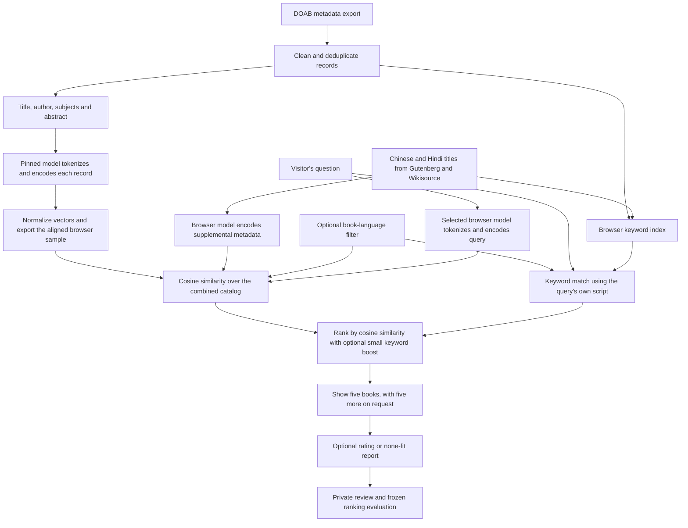

# From a book record to a search result

The 91,667-book research baseline encodes published metadata and abstracts. The default multilingual E5 small model uses a 512-token maximum, mean pooling and unit-length vectors. The browser uses the selected quantized model for the query and supplemental records. The E5 variants use separate query and passage prefixes. GTE base uses its first-token embedding. Cosine similarity is the dot product of the normalized vectors. Semantic mode is the browser default. The optional key-terms mode adds a bounded keyword bonus of up to 0.025 to each cosine score. The language filter applies before ranking in both modes.

The [book-text pilot](../Evaluation/book-text-pilot.md) compares metadata with partial and complete book text outside the deployed index. The [feedback review instructions](../Feedback/runbook.md#test-ranking-changes-with-reviewed-feedback) explain how to use visitor reports in an offline evaluation.
