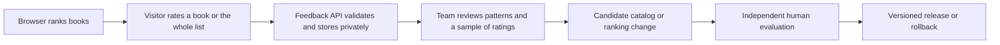

# Public recommendation feedback: implemented design

**Status:** Feedback collection is live in the [browser demo](https://veedantbrahmbhatt.github.io/Libraries/). The separate API is deployed at `https://violet-library-feedback.fabled-tetra-1279.chatgpt.site` with private D1 storage. No model update has been made.

## Decision and scope

Any visitor to the public demo may rate an individual book recommendation. The site has no login, NYU identity check, student profile, or personalized model. Feedback is therefore **visitor feedback**, not verified student judgment. It is a signal for investigation and human review; it never changes live ranking automatically.

The current 1,884-book browser sample is drawn from earlier evaluation results and has thin coverage for arbitrary topics. A “none fit” report may reveal a missing book rather than a ranking error. Improving sample coverage is a prerequisite for using broad-topic feedback to judge the model. The full 91,667-book research index remains outside the public browser demo.

## Visitor experience

Each displayed book card offers **Looks useful**, **Partly fits**, and **Does not fit**. A visitor may choose one short reason: wrong topic, too advanced, too basic, wrong language, inaccessible link, poor description, or other. A separate **None of these books fit** control applies to the whole result list. Unrated books are unknown, never negative examples. Labels refer to the preview and recommendation, not a claim that the visitor read the entire book.

The first rating shows a short notice: submitting sends the current question, the shown book IDs and positions, and the selected rating to the project team for search improvement. The visitor may cancel. No feedback is sent merely because someone searched, viewed, or opened a book. There is no free-text comment in the first public release; this limits personal-information exposure and spam. A later comment field needs a separate moderation and privacy review.

The interface acknowledges a saved rating, permits a correction or deletion in the same browser session, and keeps its receipt in memory only. If feedback is unavailable, search results still render and a clear retry message appears. The visible relevance number remains a relative ranking score, not a measure of whether the visitor is right.

## Data flow and boundaries

GitHub Pages remains the static UI. A separate Cloudflare Worker and private D1 database, provisioned by the connected Sites project, accept feedback; they do **not** choose search candidates or rank books. The API is a replaceable boundary so the team can move to an institution-approved service later. Current free-service quotas and availability are not guaranteed. GitHub Pages cannot run the receiving API itself. [GitHub Pages](https://docs.github.com/en/pages/getting-started-with-github-pages/creating-a-github-pages-site), [Workers limits](https://developers.cloudflare.com/workers/platform/limits/), [D1 limits](https://developers.cloudflare.com/d1/platform/limits/).

Each submitted rating sends a search snapshot: trimmed query (maximum 500 characters), displayed book IDs and positions (at most ten), selected model and mode, catalog checksum, ranking release, and a random idempotency key. Every rating carries its own snapshot; the API does not link ratings into a session or profile. The server validates known book IDs, allowed values, payload size, and version fields; it never trusts client-supplied scores as proof of relevance. A correction updates the current rating and records an audit event without double-counting the old one. No NYU email, student ID, major, course record, persistent device ID, or profile is stored by the application.

The database is private. The public site receives only submission status and its own receipt; it cannot read other visitors' feedback. Raw questions and ratings do not enter the public GitHub repository, Actions artifacts, or logs. Limit access to named maintainers, document who can export data, and remove raw submissions after a proposed 90-day review window unless a visitor deletes them sooner. Keep only reviewed, minimized research examples for longer use, with a separate retention decision. Platform-level logs and data-location terms must be checked before accepting real student use. [NIST minimization principle](https://csrc.nist.gov/glossary/term/minimization).

## Public endpoint controls

The current service uses HTTPS, checks the exact Pages origin for browser requests, enforces request size and daily per-IP limits, and deduplicates retries with the idempotency key. Origin/CORS checks do not authenticate callers; a bot challenge is **not** yet present. Unknown catalog IDs, malformed ratings, oversized text, and mismatched catalog versions are rejected. On a free-tier cap, stop accepting feedback cleanly rather than weakening limits. These controls follow [OWASP's guidance on API resource limits](https://api-security.owasp.org/editions/2023/en/0xa4-unrestricted-resource-consumption/). Anonymous public voting remains susceptible to coordinated manipulation, so ratings cannot serve as verified human labels by themselves.

## How feedback improves search

1. **Triage weekly:** Count wrong-topic, level, language, access, description, and none-fit reports by query type and release. Inspect examples without treating votes as truth.
2. **Audit coverage first:** Check whether a suitable book exists in the sampled catalog. If absent, broaden the sample or catalog; ranking changes cannot retrieve an absent book.
3. **Correct data:** Fix source placeholders, weak descriptions, subject mapping, and broken links in a versioned preparation run.
4. **Tune ranking offline:** Compare controlled keyword/semantic weights, explicit reading-level and language handling, or a small reranker. Do not fine-tune an encoder until varied, reviewed data shows that simpler changes are insufficient.
5. **Human-review candidates:** Sample positive and negative visitor reports for blind, source-grounded review using the existing 0/1/2 relevance rubric. Record disagreement and keep visitor ratings separate from reviewer grades.
6. **Evaluate on held-out questions:** Split by question family before tuning so near-duplicate queries cannot leak into both development and acceptance. Compare the new and prior release on the same catalog and model versions, including language and reading-level slices.
7. **Release deliberately:** Publish only when the frozen evaluation improves without material regressions; keep the prior ranking available for rollback. Track release, model, catalog, and feedback schema versions together.

The existing target of **more than 40/50** clearly useful first-five searches means at least **41/50** on a frozen, independent, human-graded set. A larger set of natural questions is needed before claiming general student usefulness. Public visitor ratings can guide what to test, but cannot replace that acceptance set. Clicks and silence are weaker signals because result position and presentation affect behavior. [Google research on position bias](https://research.google.com/pubs/archive/46485.pdf), [NIST feedback and measurement guidance](https://airc.nist.gov/airmf-resources/airmf/5-sec-core/).

## Alternatives considered

| Approach | Fit for this phase | Trade-off |
| --- | --- | --- |
| Public form or issue | No | Easy to start, but query/feedback privacy, attribution, and versioning are weak. |
| Private API and database | Recommended | Supports structured, reviewable submissions; requires a separate free account and operational care. |
| Institution-managed backend | Later | Best route for durable public service and approved data governance; outside the zero-cost prototype. |

## Release boundaries

This proposal does not add real authentication, profiles, automatic online training, personalized ranking, or full-catalog public search. A free service has quotas and no guaranteed production capacity. The feedback feature may be publicly accessible while the resulting data remains low-trust until reviewed.
